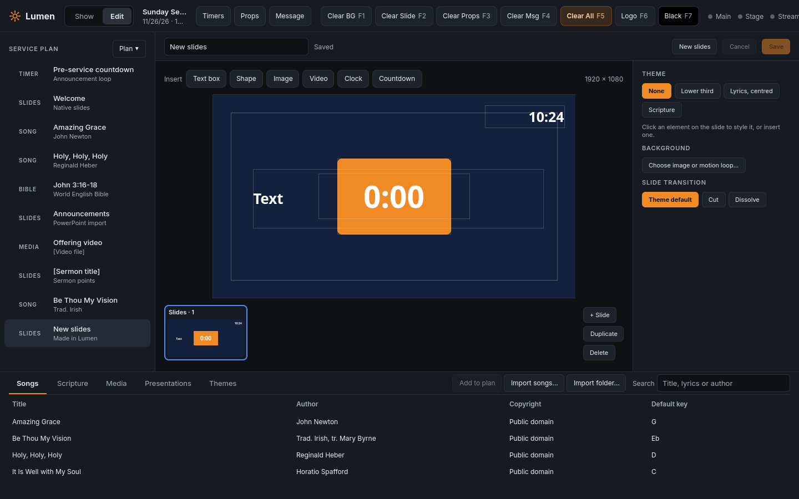
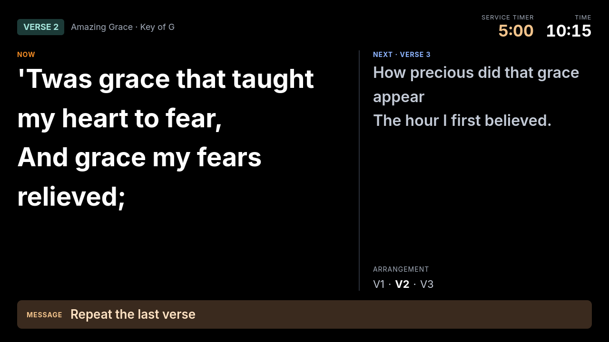

# Lumen Presenter

Free, offline, cross-platform software for showing lyrics, scripture, media and slides in worship services: in the space of EasyWorship and ProPresenter, free for every church, with no accounts, licence keys or internet needed.


Licensed under GPL-3.0 (see [LICENSE](LICENSE)). Built with C++20 and Qt 6 (QML), for Windows, macOS and Linux.

## What it does

- **Songs:** import plain text, OpenLyrics, OpenLP, EasyWorship and ProPresenter 5/6 libraries; sections split into slides automatically; arrangements (V1 C V2 C B C); search by title, author or any words of the lyrics, ignoring accents.
- **Scripture:** type `jn 3 16-18` and press Enter. Ten free Bibles are bundled (English WEB, KJV, BSB, ASV; Yoruba, Hausa, Igbo, Swahili; French; Spanish), with each one's copyright line; add more USFM/USFX Bibles from a folder.
- **Themes:** fonts, colours, outline, shadow, safe area and footers; text shrinks to fit; Yoruba, Igbo and Hausa letters and tone marks drawn correctly.
- **Media:** videos and pictures as slides or looping motion backgrounds, hardware-decoded, preloaded so they start at once.
- **Presentations:** PowerPoint and PDF imported as slides in show order.
- **Service plans:** headers, notes, reordering, duplicating, `.lumen` files to carry a plan (with its songs and media) to another computer; saved as you go, daily backups, crash recovery.
- **Live control:** layered output (background, media, slide, props, messages), fades, Clear per layer, Logo and Black, keyboard shortcuts; timers and countdowns; messages and templates ("Parent of {number}…") as a banner or ticker; lower thirds and logos that stay up across slides.
- **Outputs:** the audience screen in a separate process (a crashed or frozen operator window never freezes the screen); a stage display for musicians and the speaker; a stream output with transparency as key and fill (NDI experimental).
- **Slide editor:** text boxes, shapes, pictures, videos, clocks and countdowns placed and styled on a canvas; songs edited as lyrics.
- **On the local network (all off until turned on):** share plans and songs between computers; a phone and tablet remote in any browser; MIDI controllers (with learn); OSC; an HTTP API.
- **Timecode cues** (optional, off by default): slides that follow a backing track to the frame.

See the [user guide](docs/user-guide.md) for how to use each part.

| | |
| --- | --- |
|  |  |
| The slide editor | The stage display |
|  |  |
| The theme editor | The phone remote |

## Install

Download the installer for your computer from the **[Releases page](https://github.com/OrisabinoneDanielO/Lumen/releases)**. Every installer includes everything Lumen needs, the Bibles too; Lumen never needs the internet, an account or a licence key.

| Your computer | Download |
| --- | --- |
| Windows 10 or 11 (64-bit) | `Lumen-Presenter-<version>-windows-x64.msi` |
| macOS 12 or newer (Apple Silicon and Intel) | `Lumen-Presenter-<version>-macos.dmg` |
| Linux, any distribution | `Lumen-Presenter-<version>-x86_64.AppImage`, or the Flatpak |
| Debian 13, Ubuntu 25.04 or newer | `lumen-presenter_<version>_amd64.deb` |
| Fedora | `lumen-presenter-<version>-1.x86_64.rpm` |

Before the first release, the newest installers are attached to each run of the [Packages workflow](https://github.com/OrisabinoneDanielO/Lumen/actions/workflows/packages.yml) (open a run and scroll to **Artifacts**; you need to be signed in to GitHub).

The Windows and macOS installers are **not code-signed yet**, so the first time, Windows and macOS warn that the app is from an unknown developer. The steps below say how to get past that warning.

### Windows

1. Double-click the `.msi` file.
2. If **Windows protected your PC** appears, click **More info**, then **Run anyway**.
3. Follow the installer. Lumen Presenter is installed in `C:\Program Files\Lumen Presenter` and added to the Start menu and the desktop.

To **update**, run the newer `.msi`: it replaces the old version and keeps your library. To **uninstall**: **Settings → Apps → Installed apps → Lumen Presenter → Uninstall** (your library is kept).

### macOS

1. Open the `.dmg` file and drag **Lumen Presenter** onto **Applications**.
2. Open Lumen Presenter from Applications. The first time, macOS says it cannot check the app for malicious software:
   - **macOS 15 or newer:** click **Done**, open **System Settings → Privacy & Security**, scroll down to the message about Lumen Presenter and click **Open Anyway**, then confirm.
   - **macOS 12 to 14:** right-click (or Control-click) the app in Applications, choose **Open**, then **Open** again.
3. Allow access when macOS asks (for example to the microphone or local network). Lumen uses the local network only for features you turn on, such as the phone remote.

To **update**, drag the newer version to Applications and choose **Replace**. To **uninstall**, drag Lumen Presenter from Applications to the Bin.

### Linux

**AppImage** (any distribution): make it executable and run it.

```sh
chmod +x Lumen-Presenter-*-x86_64.AppImage
./Lumen-Presenter-*-x86_64.AppImage
```

Most file managers can do the same: right-click → **Properties → Permissions → Allow executing as program**, then double-click. If it says FUSE is missing, install `libfuse2` (Debian, Ubuntu) or `fuse-libs` (Fedora), or run it with `APPIMAGE_EXTRACT_AND_RUN=1`.

**Flatpak:**

```sh
flatpak remote-add --if-not-exists --user flathub https://dl.flathub.org/repo/flathub.flatpakrepo
flatpak install --user Lumen-Presenter.flatpak
flatpak run io.github.OrisabinoneDanielO.Lumen
```

**Debian and Ubuntu** (`.deb`, Debian 13 or Ubuntu 25.04 and newer):

```sh
sudo apt install ./lumen-presenter_*_amd64.deb
```

**Fedora** (`.rpm`):

```sh
sudo dnf install ./lumen-presenter-*.x86_64.rpm
```

Fedora's own FFmpeg leaves out some video formats (such as H.264 `.mp4`); to play those, install `ffmpeg` from [RPM Fusion](https://rpmfusion.org/Configuration).

After installing, Lumen Presenter is in your desktop's app list (or run `lumen`). To uninstall: `sudo apt remove lumen-presenter`, `sudo dnf remove lumen-presenter`, `flatpak uninstall io.github.OrisabinoneDanielO.Lumen`, or delete the AppImage.

### Checking an installation

`lumen --check-install` checks that the window, the Bibles and the audience output all work, and prints a line for each; every line should start with `ok`.

- **Windows:** `"C:\Program Files\Lumen Presenter\lumen.exe" --check-install > check.txt`, then open `check.txt`
- **macOS:** `"/Applications/Lumen Presenter.app/Contents/MacOS/Lumen Presenter" --check-install`
- **Linux:** `lumen --check-install`

## Use

The [user guide](docs/user-guide.md) explains every part. To get going:

1. **Connect the screens.** Plug in the projector, TV or stage monitor and set each one as an *extended* display (not mirrored) in your system's display settings. The first time Lumen starts with these screens, every screen shows its number in large type and the **Screens** panel asks what each one is for: **Main output** (what the congregation sees), **Stage** (current and next slide, clock and messages for the musicians and the speaker) or **Not used**. Lumen remembers your choice for these screens and puts the outputs back on them at every start; change it any time with **Plan ▾ → Screens…**. With only one screen, the output opens in a window. Click **Main** in the toolbar to turn the output off or on.
2. **Add songs.** In the library, **Import songs…** reads plain-text lyrics, OpenLyrics, and libraries from OpenLP, EasyWorship 6/7 and ProPresenter 5/6. **Import folder…** reads a whole folder. Sections are split into slides automatically.
3. **Add media and slides.** The **Media** tab takes videos and pictures (as slides or looping backgrounds). The **Presentations** tab takes PowerPoint and PDF files.
4. **Make a service plan.** Choose **Plan ▾ → New plan…** above the service plan. In the library, pick each song, media item or presentation and click **Add to plan**, then drag items into service order. **Plan ▾ → Add header…** separates parts of the service (Worship, Sermon). Everything is saved as you go, with a daily backup.
5. **Run the service.** Click a slide to send it live, or use the keyboard. Clicking a song, video, picture or plan item puts it in Preview; double-clicking puts it on the screen at once. The **Transition** box chooses cut, fade, push, wipe or zoom.

   | Key | Does |
   | --- | --- |
   | Space or → / ← | next / previous slide |
   | Page Down / Page Up | next / previous plan item |
   | C, B, P, E / V and a number | jump to Chorus, Bridge, Pre-chorus, Ending / Verse *n* |
   | F1 to F5 | clear background, slide, props, messages, everything |
   | F6 / F7 | Logo / Black |
   | Ctrl+B (Cmd+B on a Mac) | scripture, in its own window: book, chapter and verse (`j` Space `3` Space `16`), ← and ↑ to go back, Enter for Preview, Shift+Enter to show it now |

6. **More:** in the toolbar, **Timers** (countdowns and clocks), **Message** (for example "Parent of 42, please come to the nursery") and **Props** (lower thirds and logos). The **Stage** and **Stream** lights beside **Main** set up a screen for the musicians and the speaker, and an output with transparency for live streams. **Plan ▾ → Remote control and MIDI…** sets up the phone remote, MIDI and OSC; **Plan ▾ → Share with other computers…** shares plans and songs on the local network. Each of these is off until you turn it on.

**Your library** (songs, plans, media, backups) is kept on your computer:

| System | Folder |
| --- | --- |
| Windows | `%APPDATA%\Lumen\Lumen Presenter` |
| macOS | `~/Library/Application Support/Lumen/Lumen Presenter` |
| Linux | `~/.local/share/Lumen/Lumen Presenter` (Flatpak: `~/.var/app/io.github.OrisabinoneDanielO.Lumen/data/Lumen/Lumen Presenter`) |

Lumen never updates itself. **Plan ▾ → Check for updates…** tells you when a newer version is published (and can check at each start if you turn that on); you then install it as you installed Lumen.

To move a service to another computer, choose **Plan ▾ → Export plan…** to save a `.lumen` file (the plan with its songs and media), then **Plan ▾ → Import plan…** on the other computer.

## Status

All 20 batches of the design doc's build plan are built, each with tests for its "Done when" condition, followed by installers for every system and a screen setup; 41 tests run on every build, and CI runs them on Windows, macOS and Linux and installs and checks every installer. Some things have only been tested on the developer's Fedora laptop or with stand-ins (virtual MIDI, generated song libraries, two processes instead of two PCs): [docs/status.md](docs/status.md) lists exactly what has been tested how, and what has not. The MVP gate in the design doc (10 pilot churches, 4 Sundays) has not started.

## Building

Needs CMake 3.24+, Ninja, a C++20 compiler and Qt 6.5+ with Multimedia and PDF (CI uses Qt 6.8). Linux also needs the ALSA headers for MIDI.

```sh
cmake --preset debug          # or: release
cmake --build --preset debug
ctest --preset debug          # every test, offscreen
./build/debug/bin/lumen                    # opens your library (empty the first time)
```

Per-platform setup (Fedora, Ubuntu, Windows, macOS), the AppImage and the long-running tests are in [docs/building.md](docs/building.md).

## How it is put together

```
app/        operator window: QML UI (app/ui) and its C++ controllers (app/operator)
core/       data layer (SQLite), show controller, songs, scripture, render link
render/     lumen-render: the output process (audience, stage and stream)
tools/      build-time tools (lumen-bible-build)
bibles/     bundled Bible translations and their licences
tests/      unit and integration tests (Qt Test), test data and scripts
packaging/  installers: Windows .msi, macOS .dmg, Linux AppImage, Flatpak, .deb, .rpm
thirdparty/ RtMidi (MIT), for MIDI input
docs/       user guide, architecture, decisions, design doc
design/     UI mockups (open design/mockups/index.html)
```

[docs/architecture.md](docs/architecture.md) explains the processes, the modules, how a slide gets to the screen, the data model and the render protocol.

## Contributing

Contributions are welcome: code, testing with real hardware and real song libraries, translations, documentation. Start with [CONTRIBUTING.md](CONTRIBUTING.md); [docs/status.md](docs/status.md) lists good places to help. Please follow the [code of conduct](CODE_OF_CONDUCT.md).

## Credits and licences

- Lumen Presenter: GPL-3.0.
- Fonts: [Inter](https://github.com/rsms/inter) 4.1 for the operator window and stage display (`app/ui/fonts/OFL.txt`); Noto Sans and Noto Serif for the output (`core/fonts/OFL.txt`); all SIL Open Font License 1.1.
- Bibles: see [bibles/README.md](bibles/README.md) for each translation's licence.
- [RtMidi](https://github.com/thestk/rtmidi) 6.0.0 by Gary P. Scavone, MIT (`thirdparty/rtmidi/LICENSE`).
