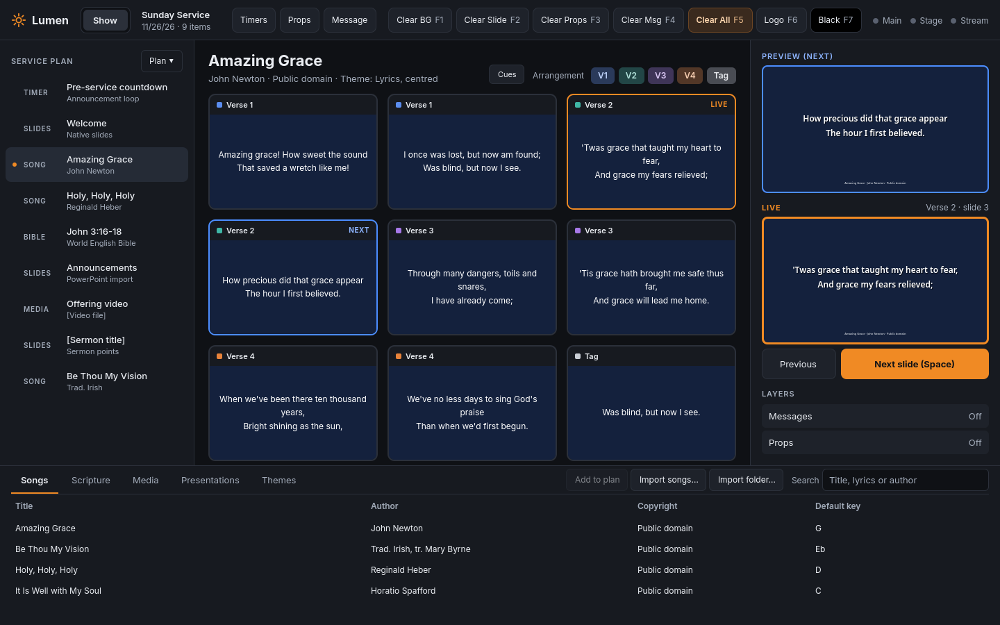
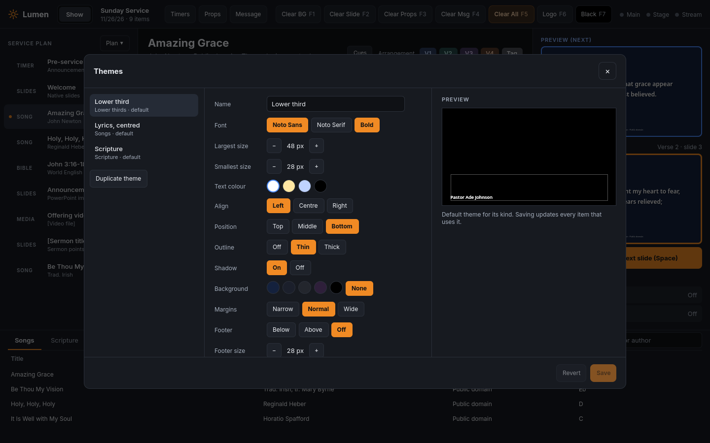
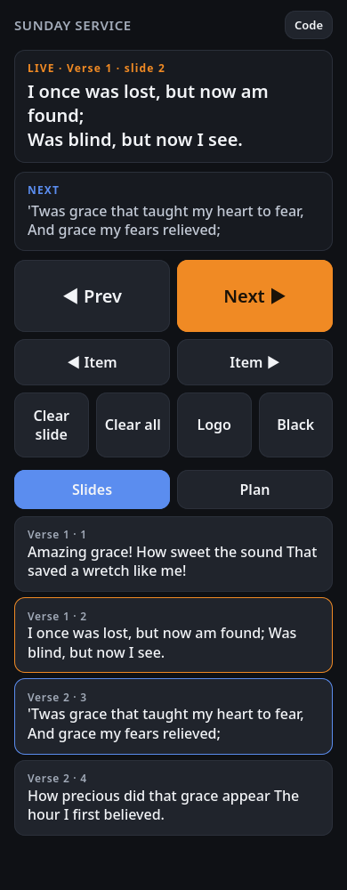

# Lumen Presenter

Free, offline, cross-platform software for showing lyrics, scripture, media and slides in worship services: in the space of EasyWorship and ProPresenter, free for every church, with no accounts, licence keys or internet needed.



Licensed under GPL-3.0 (see [LICENSE](LICENSE)). Built with C++20 and Qt 6 (QML), for Windows, macOS and Linux.

## What it does

- **Songs:** import plain text, OpenLyrics, OpenLP, EasyWorship and ProPresenter 5/6 libraries; sections split into slides automatically; arrangements (V1 C V2 C B C); search by title, author or any words of the lyrics, ignoring accents.
- **Scripture:** type `jn 3 16-18` and press Enter. Ten free Bibles are bundled (English WEB, KJV, BSB, ASV; Yoruba, Hausa, Igbo, Swahili; French; Spanish), with each one's copyright line; add more USFM/USFX Bibles from a folder.
- **Themes:** fonts, colours, outline, shadow, safe area and footers; text shrinks to fit; Yoruba, Igbo and Hausa letters and tone marks drawn correctly.
- **Media:** videos and pictures as slides or looping motion backgrounds, hardware-decoded, preloaded so they start at once.
- **Presentations:** PowerPoint and PDF imported as slides in show order.
- **Service plans:** headers, notes, reordering, duplicating, `.lumen` files to carry a plan (with its songs and media) to another computer; saved as you go, daily backups, crash recovery.
- **Live control:** layered output (background, media, slide, props, messages), fades, Clear per layer, Logo and Black, keyboard shortcuts; timers and countdowns; messages and templates ("Parent of {number}…") as a banner or ticker; lower thirds and logos that stay up across slides.
- **Outputs:** the audience screen in a separate process (a crashed or frozen operator window never freezes the screen); a stage display for musicians and the speaker; a stream output with transparency as key and fill (NDI experimental).
- **Slide editor:** text boxes, shapes, pictures, videos, clocks and countdowns placed and styled on a canvas; songs edited as lyrics.
- **On the local network (all off until turned on):** share plans and songs between computers; a phone and tablet remote in any browser; MIDI controllers (with learn); OSC; an HTTP API.
- **Timecode cues:** slides that follow a backing track to the frame.

See the [user guide](docs/user-guide.md) for how to use each part.

| | |
| --- | --- |
|  |  |
| The slide editor | The stage display |
|  |  |
| The theme editor | The phone remote |

## Status

All 20 batches of the design doc's build plan are built, each with tests for its "Done when" condition; 39 test programs run on every build. Some things have only been tested on the developer's Fedora laptop or with stand-ins (virtual MIDI, generated song libraries, two processes instead of two PCs): [docs/status.md](docs/status.md) lists exactly what has been tested how, and what has not. The MVP gate in the design doc (10 pilot churches, 4 Sundays) has not started.

## Building

Needs CMake 3.24+, Ninja, a C++20 compiler and Qt 6.5+ with Multimedia and PDF (CI uses Qt 6.8). Linux also needs the ALSA headers for MIDI.

```sh
cmake --preset debug          # or: release
cmake --build --preset debug
ctest --preset debug          # every test, offscreen
./build/debug/bin/lumen                    # opens your library (empty the first time)
```

Per-platform setup (Fedora, Ubuntu, Windows, macOS), the AppImage and the long-running tests are in [docs/building.md](docs/building.md).

## How it is put together

```
app/        operator window: QML UI (app/ui) and its C++ controllers (app/operator)
core/       data layer (SQLite), show controller, songs, scripture, render link
render/     lumen-render: the output process (audience, stage and stream)
tools/      build-time tools (lumen-bible-build)
bibles/     bundled Bible translations and their licences
tests/      unit and integration tests (Qt Test), test data and scripts
packaging/  installers (Linux AppImage so far)
thirdparty/ RtMidi (MIT), for MIDI input
docs/       user guide, architecture, decisions, design doc
design/     UI mockups (open design/mockups/index.html)
```

[docs/architecture.md](docs/architecture.md) explains the processes, the modules, how a slide gets to the screen, the data model and the render protocol.

## Contributing

Contributions are welcome: code, testing with real hardware and real song libraries, translations, documentation. Start with [CONTRIBUTING.md](CONTRIBUTING.md); [docs/status.md](docs/status.md) lists good places to help. Please follow the [code of conduct](CODE_OF_CONDUCT.md).

## Credits and licences

- Lumen Presenter: GPL-3.0.
- Fonts: [Inter](https://github.com/rsms/inter) 4.1 for the operator window and stage display (`app/ui/fonts/OFL.txt`); Noto Sans and Noto Serif for the output (`core/fonts/OFL.txt`); all SIL Open Font License 1.1.
- Bibles: see [bibles/README.md](bibles/README.md) for each translation's licence.
- [RtMidi](https://github.com/thestk/rtmidi) 6.0.0 by Gary P. Scavone, MIT (`thirdparty/rtmidi/LICENSE`).
